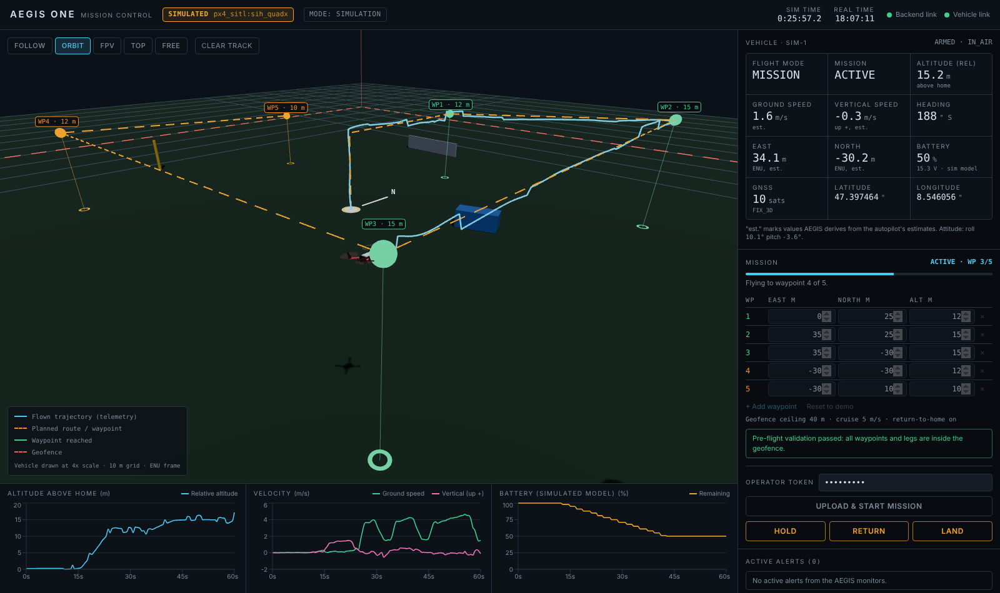

# AEGIS ONE

Simulation-first autonomous drone research platform: PX4 software-in-the-loop flight, a typed
telemetry/mission backend, and a 3D mission-control dashboard. Intended for authorized,
non-weapon robotics research, environmental inspection and search and rescue, always with a
human operator in control.

**Status: Phases 0 to 2 complete; Phase 3 (navigation and mapping), Phase 4 (thermal search and
rescue), Phase 5 (multi-vehicle) and Phase 6 (anomaly detection and security monitoring) built and verified with software sensor models on PX4's
built-in simulator.** A simulated PX4 quadcopter flies
geofenced, obstacle-checked waypoint missions commanded from the dashboard, with live telemetry,
alerts, object detection and tracking, 3D occupancy mapping from depth, detour planning, search
patterns with a thermal camera model, heat-source candidates that wait for the operator's
decision, search reports, and synchronized recording and replay. With the Gazebo depth camera
the map currently misses its accuracy targets because of a heading-estimate error (see
[docs/testing/README.md](docs/testing/README.md)). Several vehicles can fly at once with route-conflict checks and a separation monitor.
Anomaly detection and security monitoring are later phases and are **not** implemented yet (see
[docs/ROADMAP.md](docs/ROADMAP.md)).

No drone hardware is needed. No physical-flight code path exists in this release.



## What works today

| Capability | State |
| --- | --- |
| PX4 v1.17.0 SITL flight stack with PX4's built-in physics (SIH quadcopter) | Verified |
| Telemetry adapter (MAVSDK), typed contracts with provenance, frames and units | Verified |
| Waypoint missions: validate, upload, arm, fly, return, land | Verified against PX4 SITL |
| Geofence: checked before upload, uploaded to PX4, monitored during flight | Verified (pre-flight + monitor); PX4 breach action not yet exercised |
| Operator intervention: hold / return / land, token-gated | Verified against PX4 SITL |
| Unreachable-waypoint detection (leg timeout, then hold) | Verified |
| Advisory alerts: link loss, stale data, battery, GNSS, estimator, geofence | Unit-tested with injected faults |
| Flight recording (JSONL) and replay, re-labelled as `replayed` | Verified |
| 3D dashboard: drone pose, trajectory, route, geofence, obstacles, 5 camera modes, charts | Verified in a browser |
| Gazebo Harmonic world for Environment A (generated from the scenario file) | Launch confirmed by the project owner on WSL2; not independently re-verified |
| Object detection (YOLO11n via ONNX Runtime, CPU), swappable backend | Verified on real photos; precision/recall measured on a tiny sample set |
| Multi-object tracking (Kalman + Hungarian), IDs, histories, short-occlusion coasting | Verified on synthetic ground truth and a real-model video run |
| Camera sources: video file, TCP frame stream | Verified |
| Dashboard video panel: boxes, track IDs, trails, click-to-highlight, latency | Verified in a browser |
| Session recording (flight + camera video + detections) and synchronized replay | Verified |
| Environment B (urban street with staged people and vehicles) | Dashboard and built-in simulator verified; **Gazebo world not yet launched** |
| Demo 2 (AI detection) script | Logic rehearsed with a video file; **not yet run against Gazebo** |
| Gazebo camera to AEGIS bridge (`scripts/gz_camera_bridge.py`) | Confirmed working by the project owner |
| Depth sensing: software depth sensor (ray casting against the scenario) | Verified |
| 3D occupancy mapping from depth, save / load, accuracy against ground truth | Verified (Demo 4: precision 0.99, recall 0.93 of observed surface) |
| Obstacle-aware mission validation (known obstacles + live map) | Verified |
| Route monitoring with automatic Hold, operator-approved detour planning (A*) | Verified live against PX4 SITL |
| Gazebo depth camera link (`gazebo-depth` + `gz_camera_bridge.py --depth`) | Runs on the owner's machine. Map accuracy 0.74 / 0.75 with the autopilot's pose (below target), 0.998 / 0.82 with the simulator's true pose: the autopilot's heading is 2 to 6 degrees off |
| Thermal camera (software model, stabilised mount), heat-source detection and geolocation | Verified (model data only) |
| Search-pattern planning, coverage tracking, candidate review workflow, search report | Verified live against PX4 SITL (Demo 3: 8 of 8 criteria) |
| Wind disturbances, depth-image view in the dashboard | Not built |
| Several vehicles at once: shared frame, per-vehicle missions and commands, Hold all | Verified live with two PX4 instances (Demo 5: 8 of 8 criteria) |
| Route-conflict refusal between vehicles | Verified live |
| Automatic Hold when two airborne vehicles get too close | Unit-tested; **not triggered in a live flight** |
| Telemetry anomaly detection (8 checks, advisory) and fault injection to test it | Verified live against PX4 SITL (Demo 6: 8 of 8 criteria) |
| Command audit log with hash chain, failed-login and remote-command alerts, posture check | Verified (Demo 6 and unit tests) |
| Thermal imagery rendered by Gazebo, replay of thermal or fleet sessions, fleets under Gazebo | Not built |
| ROS 2 Jazzy bridge, LiDAR | Not started |

"Verified" means it was executed and observed; the commands and results are in
[docs/testing/README.md](docs/testing/README.md).

### About the simulator

The project brief names Gazebo as the authoritative physics simulation. The machine this
repository was first built on could not install Gazebo, so Phase 1 was verified with **SIH**,
the rigid-body quadcopter simulator that ships inside PX4. It runs the same PX4 flight stack,
estimator, mission logic and MAVLink interface; it has no cameras, LiDAR or collision geometry.
AEGIS talks to PX4 only over MAVLink, so switching to Gazebo changes one launch command and no
application code. Obstacles shown in the dashboard are physical only under Gazebo.
Details: [docs/simulation/README.md](docs/simulation/README.md).

## Quick start (Windows + WSL2, Ubuntu 24.04)

```bash
# 1. One-time setup inside WSL2 (installs PX4 v1.17.0 + Gazebo Harmonic, Python and Node deps)
git clone https://github.com/rmanna80/AEGIS-ONE.git && cd AEGIS-ONE
bash scripts/setup_wsl.sh              # or: bash scripts/setup_wsl.sh --no-gazebo

# 2. Terminal A: the simulated drone
bash scripts/run_px4.sh sih            # or: bash scripts/run_px4.sh gazebo

# 3. Terminal B: backend + dashboard
#    (edit .env first and set AEGIS_OPERATOR_TOKEN to a value of your choice)
bash scripts/run_backend.sh
```

`setup_wsl.sh` has not been run end to end yet (PX4 was built with the same tag and target, but
by hand), so expect to adjust it on first use.

Open <http://127.0.0.1:8000>. Paste your operator token, press **Upload & start mission**, then
**Confirm**. The drone takes off, flies five waypoints, returns and lands (about 2.5 minutes).

No PX4 yet? Watch a recorded flight instead:

```bash
AEGIS_MODE=replay bash scripts/run_backend.sh
```

Frontend development with hot reload: `cd frontend && npm run dev` (http://localhost:5173,
proxies to the backend).

## Camera and object detection (optional)

Perception is off unless a camera is configured, and the rest of the platform runs without it.

```bash
bash scripts/get_detector_model.sh        # downloads YOLO11n ONNX (AGPL-3.0, not committed)
```

Try it on any video file (no Gazebo needed):

```bash
AEGIS_CAMERA=video:/path/to/clip.mp4 bash scripts/run_backend.sh
```

With the simulated drone's camera in Gazebo (three terminals):

```bash
bash scripts/run_px4.sh gazebo-cam                  # x500 with a forward RGB camera
AEGIS_CAMERA=stream bash scripts/run_backend.sh
/usr/bin/python3 scripts/gz_camera_bridge.py        # system Python, not the .venv
```

The dashboard then shows a split screen: 3D view on the left, camera with boxes and track IDs
on the right. Clicking an object highlights its track; it never changes what the drone does.
Dashed boxes marked "predicted" are tracks coasting through a missed detection or occlusion.
Measure the detector on your machine with `python scripts/eval_detector.py`.

## Demo 2: AI detection (urban scenario)

A street with three standing people and three parked vehicles; the drone makes a slow pass at
6 m and the detector has to find both kinds of target. Four terminals:

```bash
bash scripts/run_px4.sh gazebo-cam urban        # first launch downloads the models from Gazebo Fuel
AEGIS_SCENARIO=urban AEGIS_CAMERA=stream bash scripts/run_backend.sh
/usr/bin/python3 scripts/gz_camera_bridge.py
.venv/bin/python scripts/demo2_detection.py --token "$AEGIS_OPERATOR_TOKEN"
```

Acceptance criteria: mission completes; camera frames stay `simulated` and never stop; at least
one confirmed track per kind of staged target (person; car or truck); detections stored; no
critical alerts. **This has not been run against Gazebo yet.** Two things may need adjusting on
first run: the Fuel model names, and whether YOLO recognises Gazebo's rendered people and cars.
The targets are static, the route is fixed, and nothing steers the drone toward a detection.

## Navigation and mapping

Route checking against the scenario's known obstacles is on whenever the perception extra is
installed: a mission whose path comes within 3 m of an obstacle is refused before anything is
sent to the vehicle, and **Plan around obstacles** in the Mission panel proposes detour
waypoints for you to review.

Add a depth sensor to build a live 3D map (teal and yellow cubes in the 3D view):

```bash
AEGIS_SCENARIO=urban AEGIS_DEPTH=raycast bash scripts/run_backend.sh
```

`raycast` is a software depth sensor that casts rays against the scenario's geometry from the
vehicle's telemetry pose. It works with either simulator. With Gazebo's depth camera instead
(**untested**):

```bash
bash scripts/run_px4.sh gazebo-depth urban
AEGIS_SCENARIO=urban AEGIS_DEPTH=stream bash scripts/run_backend.sh
/usr/bin/python3 scripts/gz_camera_bridge.py --depth
```

During a mission AEGIS watches the route ahead in the live map. If it is blocked, or depth
sensing stops, AEGIS commands PX4's **Hold** and reports `blocked`. That is the only thing it
does on its own: it never steers. You then plan a detour and start it, or use Return / Land.

**Demo 4 (mapping)** flies the urban street, scores the map against ground truth and saves it:

```bash
python scripts/demo4_mapping.py --token "$AEGIS_OPERATOR_TOKEN"
```

**Obstacle detection and replanning** flies at a tower the route checker is not told about:

```bash
AEGIS_DEPTH=raycast AEGIS_NAV_USE_PRIOR_MAP=false bash scripts/run_backend.sh   # open_field
python scripts/demo_obstacle_replan.py --token "$AEGIS_OPERATOR_TOKEN"
```

## Demo 3: Search and rescue

```bash
bash scripts/run_px4.sh sih sar_field
AEGIS_SCENARIO=sar_field AEGIS_THERMAL=model bash scripts/run_backend.sh
.venv/bin/python scripts/demo3_sar.py --token "$AEGIS_OPERATOR_TOKEN"
```

The backend plans parallel passes over the scenario's search area for the thermal camera's
footprint; the operator reviews and starts that mission like any other. During the flight,
objects clearly warmer than their surroundings are located on the ground and, after three
sightings, listed in the dashboard's **Search** panel with a size-and-temperature description.
Each one stays `unreviewed` until the operator confirms or dismisses it. AEGIS never confirms
a candidate itself and never flies toward one; the search service has no access to vehicle
commands. `POST /api/sar/report/save` writes `sar_report.json` and `sar_report.md`.

The thermal camera is a software model reading surface temperatures from the scenario file:
no emissivity, weather, sun or time of day. It sits on an ideal stabilised mount that looks
straight down. The scenario includes a deer (indistinguishable from a person by size and
warmth) and a person under a shelter roof (not visible from above), so the demo shows a false
alarm and a miss as well as the finds.

## Demo 5: Two vehicles search one area

```bash
bash scripts/run_fleet.sh 2 sar_field
AEGIS_FLEET_SIZE=2 AEGIS_SCENARIO=sar_field AEGIS_THERMAL=model bash scripts/run_backend.sh
.venv/bin/python scripts/demo5_fleet_search.py --token "$AEGIS_OPERATOR_TOKEN"
```

`run_fleet.sh` starts up to four PX4 instances on the built-in simulator, 12 m apart. The
backend names them `sim-1`, `sim-2`, ... and puts them in one frame (the first vehicle's home).
The dashboard gets a **Fleet** panel: each vehicle's state with its own Hold / Return / Land, a
**Hold all** button, and a shared search that cuts the search area into one strip per vehicle
at different heights. Both thermal cameras feed one candidate list.

What keeps vehicles apart: a mission that passes within 10 m of a route another vehicle is
flying, without 5 m of height between them, is refused before upload; each vehicle returns at
its own altitude (30 m, 36 m, ...); and if two airborne vehicles come within 6 m horizontally
and 4 m vertically, AEGIS asks PX4 to Hold both, once, and leaves the rest to the operator.
Vehicles never coordinate on their own. The built-in simulator has no collisions, so nothing
physical is being tested here. The Mission panel, camera, mapping and replay still belong to
the first vehicle only.

## Demo 6: Anomaly detection and security monitoring

```bash
bash scripts/run_px4.sh sih
AEGIS_FAULT_INJECTION=true bash scripts/run_backend.sh
.venv/bin/python scripts/demo6_security.py --token "$AEGIS_OPERATOR_TOKEN"
.venv/bin/python scripts/verify_audit.py        # afterwards: was the command log edited?
```

Eight consistency checks run on the telemetry all the time: position against integrated
velocity (jump and slow drift), a clock that goes backwards, telemetry that stops changing,
an implausible battery, distance from the mission route, a flight mode that changes without an
operator command, and arming without a mission. They raise alerts and nothing else: the
monitor has no access to vehicle commands and cannot override the autopilot's failsafes.

Every command request, allowed or refused, is written to `audit.jsonl` in the session folder
with a hash chain, so later edits show up (the token itself is never written). Five wrong
tokens in a minute raise an alert. The dashboard's **Security** section lists configuration
findings; one it cannot fix is that the bundled MAVSDK server listens on every network
interface without authentication.

Fault injection exists to test the monitors. It is off unless the backend is started with
`AEGIS_FAULT_INJECTION=true`, needs the operator token and an attested simulator, and alters
only AEGIS's copy of the telemetry: the vehicle keeps flying on correct data. Altered data is
labelled on screen and in recordings.

## Replaying a session

Each backend run records to `data/generated/sessions/<timestamp>/` (flight log, camera video,
detections). Replay the newest one with everything in sync:

```bash
AEGIS_MODE=replay AEGIS_REPLAY_SESSION=latest AEGIS_SCENARIO=urban bash scripts/run_backend.sh
```

`AEGIS_REPLAY_SPEED=4` plays faster. `curl -s localhost:8000/api/recordings` lists sessions.

## Demo 1: Autonomous survey

```bash
python scripts/demo1_survey.py --token "$AEGIS_OPERATOR_TOKEN"
```

Submits the scenario mission through the API, follows it, and checks five acceptance criteria
(accepted, all waypoints reached, stayed inside the geofence, landed within 3 m of home and
disarmed, no critical alerts). A JSON report is written to `data/generated/demo_results/`.
Reset: the vehicle ends landed at home, so just run it again. Demos 2 to 5 arrive with their
phases.

## Tests

```bash
pytest                                   # backend unit + API tests (no PX4 needed)
ruff check . && ruff format --check . && mypy
cd frontend && npm test && npm run build
# Live simulation tests: start PX4, stop the backend (it owns UDP 14540), then:
AEGIS_SITL_TESTS=1 pytest tests/simulation -v
```

## Operating modes

| `AEGIS_MODE` | Data source | Commands |
| --- | --- | --- |
| `simulation` (default) | PX4 SITL | Allowed with the operator token, and only after the autopilot is identified as a simulation airframe |
| `monitor` | PX4 SITL | None (read-only) |
| `replay` | Recorded flight | None (read-only) |
| `physical` | n/a | Rejected at startup. Physical flight is a separately gated future milestone. |

Every state, alert and recording carries its provenance (`simulated`, `replayed`, `physical`),
and the dashboard shows it in the header at all times.

## Repository layout

```text
backend/aegis/          Python package
  contracts.py          typed data contracts (provenance, frames, units)
  frames.py             WGS84 / ECEF / ENU / NED / body conversions
  missions.py           mission model, geofence geometry, pre-flight validation
  safety.py             advisory monitors and alert tracking
  interfaces.py         hardware-abstraction protocols
  adapters/px4_sitl.py  PX4 SITL adapter (telemetry + mission executor)
  recording.py          flight recorder and replay adapter
  hub.py                sample -> monitor -> record -> broadcast loop
  api.py                FastAPI REST + WebSocket
  perception/           optional: cameras, ONNX detector, tracker, metrics, pipeline
  navigation/           optional: depth sensing, occupancy map, route checker, A* planner
backend/tests/          unit and API tests
tests/simulation/       tests that need a live PX4 SITL
frontend/               React + TypeScript + React Three Fiber dashboard
simulation/scenarios/   environment + demo mission (single source of truth)
simulation/gazebo/      generated Gazebo world
scripts/                setup, launch, demo and generator scripts
data/sample/            a real recorded SITL flight for replay mode
docs/                   architecture, simulation, safety, testing, roadmap
```

This is flatter than the structure suggested in the brief: directories are added when their
first real code lands, rather than created empty. The reasoning is in
[docs/architecture/README.md](docs/architecture/README.md).

## Safety boundaries

- AEGIS never commands actuators. It uses PX4's own mission, hold, return and land modes, so the
  flight controller's failsafes always remain in charge.
- AEGIS monitors raise alerts. The one automatic action is asking PX4 to Hold when the route
  ahead is blocked or depth sensing is lost; resuming is always the operator's decision.
- Commands are refused unless the autopilot reports a known simulation airframe.
- Passing simulation tests is not evidence of flight readiness.

More in [docs/safety/README.md](docs/safety/README.md).
