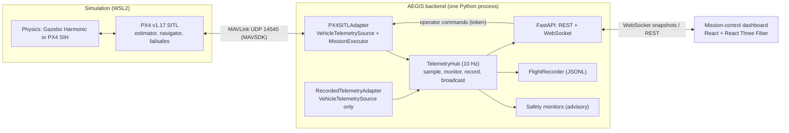

# Architecture

## Overview



One process, no microservices. The only network boundaries are MAVLink to PX4 and
HTTP/WebSocket to the browser.

## The rule that keeps hardware swappable

Everything above the adapter layer depends on two protocols in `aegis/interfaces.py`:

- `VehicleTelemetrySource`: `start()`, `stop()`, `get_state() -> VehicleState`
- `MissionExecutor`: `submit_mission()`, `mission_status()`, `hold()`, `return_to_home()`, `land()`

The hub, API, monitors, recorder and dashboard never import MAVSDK. A future Pixhawk adapter, a
Gazebo camera adapter or a Raspberry Pi camera adapter is a new class that satisfies a protocol,
plus configuration. Camera, thermal and depth protocols will be added with their first real
implementation in Phase 2 to 4 rather than declared now with nothing behind them.

## Perception (optional subsystem)

```text
CameraSource --> InferenceBackend --> MultiObjectTracker --> PerceptionResult
 video file        ONNX YOLO (CPU)      Kalman + Hungarian     -> /ws/video (JSON + JPEG)
 TCP stream        (swappable)          image-space only       -> detections JSONL
                                                                -> hub alerts (camera, latency)
```

- `CameraSource` and `InferenceBackend` are protocols in `perception/types.py`. The tracker,
  pipeline and UI never import ONNX Runtime, so the detector can change (another model, the
  IMX500 on-camera path later) without touching them.
- The backend imports perception lazily. Without the `perception` extra, a model file or a
  configured camera, everything else runs and the dashboard says why the camera is off.
- Gazebo images reach AEGIS through `scripts/gz_camera_bridge.py`, a separate process using
  Gazebo's own Python bindings and a small TCP frame protocol. Gazebo's protobuf build and the
  backend's gRPC stack have conflicting dependencies, and the same protocol will carry
  Raspberry Pi camera frames in Phase 7.
- Tracking output is image-space only (pixels, pixels per second). Selecting a track highlights
  it for the operator; no code path connects perception to vehicle commands.

## Navigation (optional subsystem)

```text
DepthSource --> OccupancyGrid (3D log-odds, ENU) --> RouteChecker --> pre-flight validation
 raycast          + prior map of known obstacles       A* planner      detour proposals
 TCP stream         from the scenario file                              route monitor -> Hold
```

- `DepthSource` is a protocol; `RaycastDepthCamera` (software sensor against scenario geometry)
  and `DepthStreamAdapter` (Gazebo depth via the bridge) implement it. A physical depth camera
  would be a third implementation.
- The same `SceneGeometry` provides the prior obstacle map, the simulated sensor and the ground
  truth that maps are scored against.
- Planning is 2D A* in the altitude band of each leg, on obstacles inflated by the clearance;
  checking is 3D along each leg. PX4's take-off, return and landing paths are checked but not
  re-routed.
- The navigation service may request PX4 Hold; it has no other path to the vehicle. Detours
  are returned to the operator as a draft mission.

## Data contracts

`aegis/contracts.py` defines the Pydantic models that cross every boundary. Conventions:

- **Provenance on everything.** `simulated`, `replayed` or `physical`. Replayed data also keeps
  the original provenance in `recorded_provenance`.
- **Units in field names.** `relative_altitude_m`, `ground_speed_m_s`, `yaw_deg`, `voltage_v`.
- **Frames in field names.** `position_enu_m`, `velocity_ned_m_s`.
- **Derived values are declared.** `VehicleState.derived_fields` lists what AEGIS computed
  rather than received, and the dashboard marks those "est.".
- **Two clocks.** `received_at_unix_s` (host wall clock) and `vehicle_time_s` (autopilot clock,
  which is simulation time under SITL).

`frontend/src/types.ts` mirrors these by hand. Generating it from the OpenAPI schema is listed
as technical debt.

## Coordinate frames

| Frame | Axes | Used for |
| --- | --- | --- |
| WGS84 | latitude, longitude (deg), altitude AMSL (m) | What PX4 reports and accepts |
| ENU (local) | x East, y North, z Up; origin = home | Mission authoring, geofences, scenarios, Gazebo worlds |
| NED (local) | x North, y East, z Down | PX4 velocities and attitude reference |
| Body FRD | x Forward, y Right, z Down | Attitude quaternion (body to NED) |
| three.js scene | +X East, +Y Up, -Z North | Rendering only |

Conversions live in `aegis/frames.py` (Python) and `frontend/src/lib/frames.ts` (TypeScript),
and both are unit-tested, including round trips, axis directions and the attitude-quaternion
change of basis. Missions are authored in ENU and converted to WGS84 only at upload.

## Mission flow

1. The dashboard edits a draft mission; each change is validated by `POST /api/missions/validate`.
2. The operator supplies the token and confirms. `POST /api/missions` reaches the adapter.
3. The adapter refuses unless the autopilot is an attested simulator, re-validates against the
   vehicle's current position, uploads the geofence and mission to PX4, arms, requests Mission
   mode and **confirms PX4 actually entered it** (the command ACK alone is not trusted).
4. PX4 flies the mission. The adapter tracks progress; if a leg exceeds its timeout it commands
   hold and reports `stalled`.
5. After the last waypoint PX4 returns and lands; the mission is `completed` once the vehicle is
   on the ground and disarmed.

## Scenario files

`simulation/scenarios/open_field.json` holds the environment geometry, geofence and demo
mission. The dashboard renders it and `scripts/generate_gazebo_world.py` turns it into the
Gazebo SDF world, so the two views cannot drift apart. CI fails if the committed world is stale.

## Deviations from the brief, and why

| Brief | This repository | Reason |
| --- | --- | --- |
| Deep directory tree up front | Flat `backend/aegis` package, directories added with real code | The brief also says not to create empty directories or placeholder files |
| `MAVSDK-Python` | `mavsdk-grpc` 4.x | In 2026 the PyPI name `mavsdk` became a new native binding with a different API; `mavsdk-grpc` is the maintained continuation of the documented API |
| Gazebo as Phase 1 physics | Verified with PX4 SIH; Gazebo world written but not yet run | Gazebo could not be installed on the build machine; see docs/simulation |
| ROS 2 in Phase 1 | Not used yet | Nothing in Phase 1 needs it; it enters with camera and LiDAR topics in Phase 2 to 3 |
| PostgreSQL / SQLite | JSONL flight recordings | Append-only logs are enough until detection events need queries (Phase 2) |
| Docker Compose | Not provided | PX4 + Gazebo GUI under WSL2 is simpler natively; revisit for CI |
